

  <picture>
    <source media="(prefers-color-scheme: dark)" srcset="logo/ohpanel-logo-nspanel-dark.svg">
    
  </picture>

  Firmware for the Sonoff NSPanel that talks to <a href="https://www.openhab.org">openHAB</a> directly. 
  <b><a href="https://bruestel.github.io/ohpanel/demo/">Try the demo</a></b> ·
  <a href="docs/install.md">Install</a> ·
  <a href="https://bruestel.github.io/ohpanel/flash/">Flash from the browser</a> ·
  <a href="docs/panel-config.md">Configure</a>

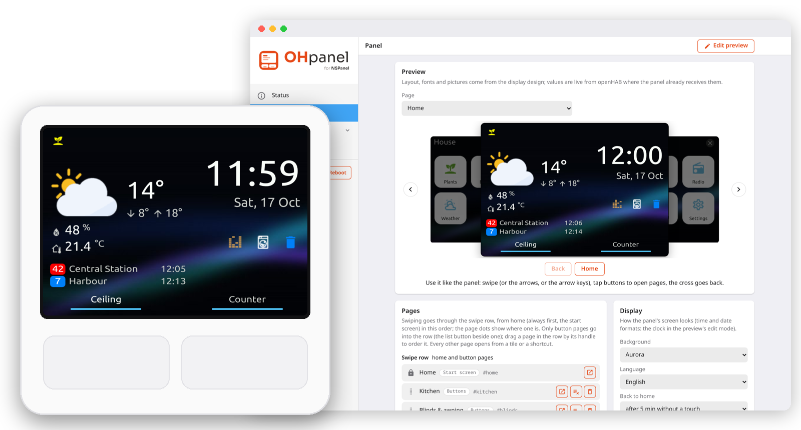

OHpanel replaces the NSPanel's firmware: item states arrive over openHAB's event stream, commands go to its
REST API. No MQTT broker, no rules to keep the panel in sync, no Home Assistant. The panel is set up in its own
web interface, which shows a live preview of the display: what you change there is what the panel shows.

## What it does

- **Pages of your own**, configured as JSON or clicked together in the web interface: buttons, lists of
  values, lights (brightness, colour temperature, colour wheel), covers and awnings (alone or as a group, with
  presets), thermostats, a media player with its cover and a station list, the weather forecast, QR codes
- **A home screen** with the weather, temperatures, status icons and shortcuts (animated, e.g. a turning
  washing machine), two info lines (the next bus, say) and the two hardware buttons with their relays,
  which openHAB can switch too
- **Setup without a cable** after the first flash: the panel opens a hotspot, finds openHAB in the network
  and is updated over WiFi, both the firmware and the display's design
- **Themes**: five backgrounds (Aurora, Black, Candy, Dunes, Forest), each with its own accent and text colours;
  any of the three colours can be set to one of your own
- **Night and idle**: dimmed when idle, off at night, back to home after a while
- **HTTPS** with a certificate authority of the panel's own, or one shared by all your panels
- **Backups** of everything, to move a configuration to another panel

## Screens

<table>
<tr>
<td>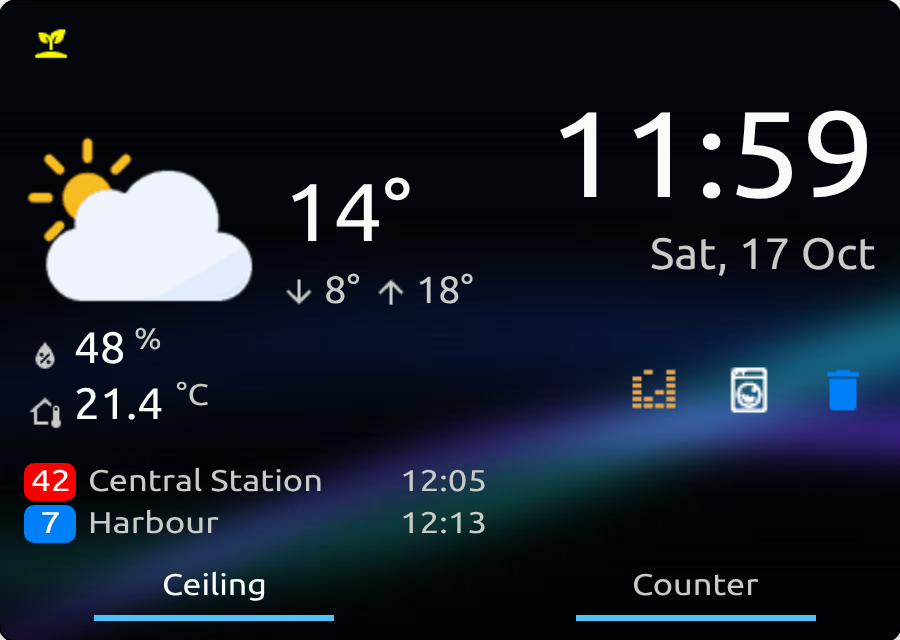</td>
<td>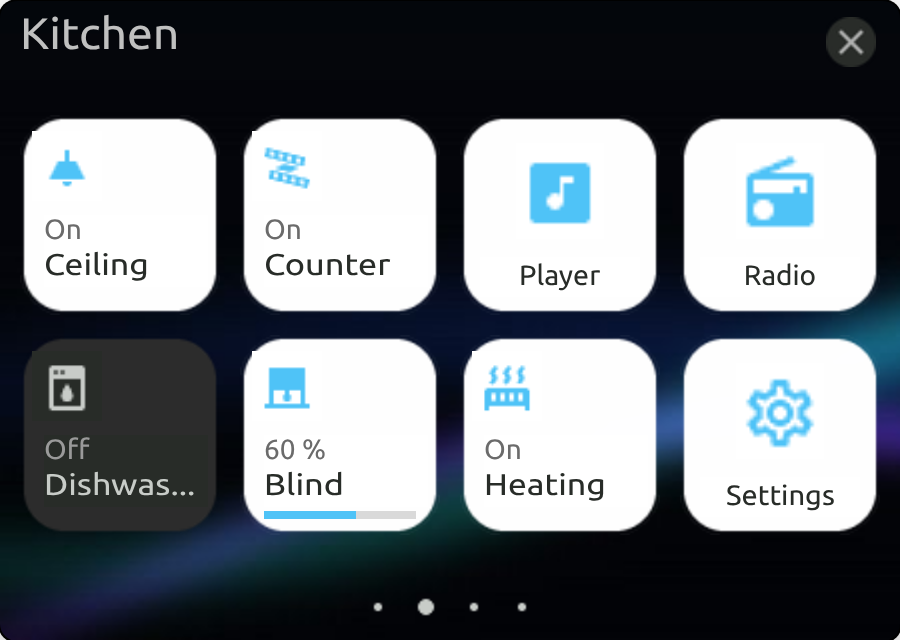</td>
<td>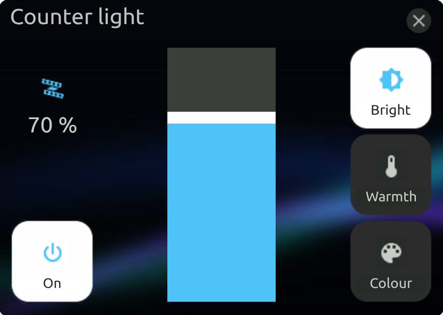</td>
</tr>
<tr><td align="center">Home</td><td align="center">Buttons</td><td align="center">Light</td></tr>
<tr>
<td>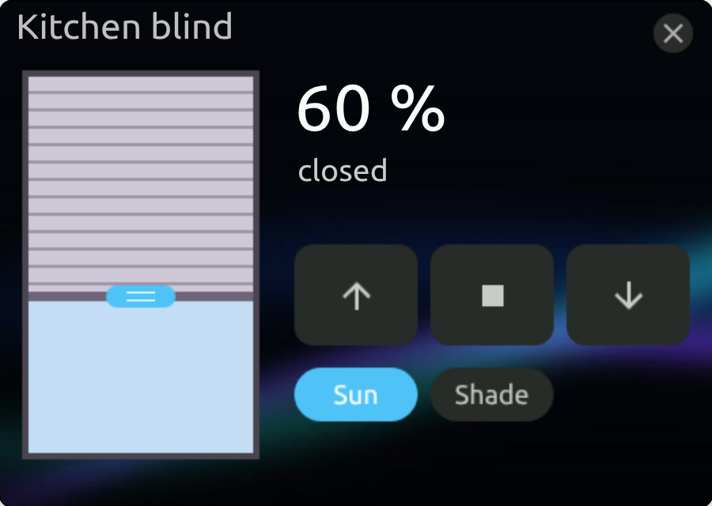</td>
<td>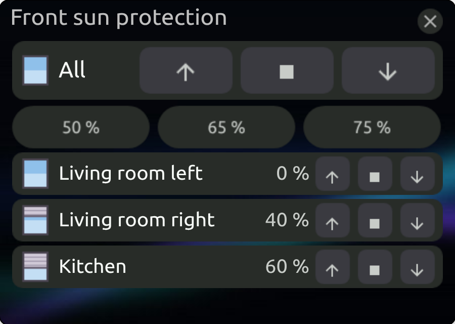</td>
<td>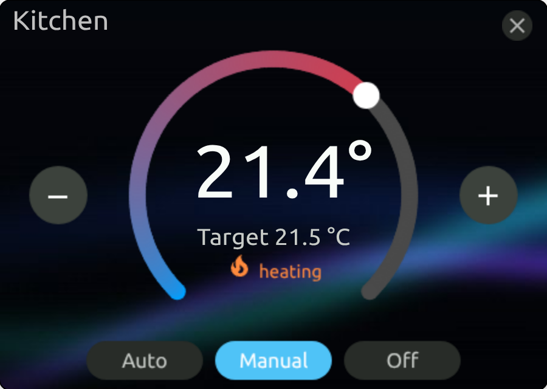</td>
</tr>
<tr><td align="center">Cover with presets</td><td align="center">A group of covers</td><td align="center">Thermostat</td></tr>
<tr>
<td>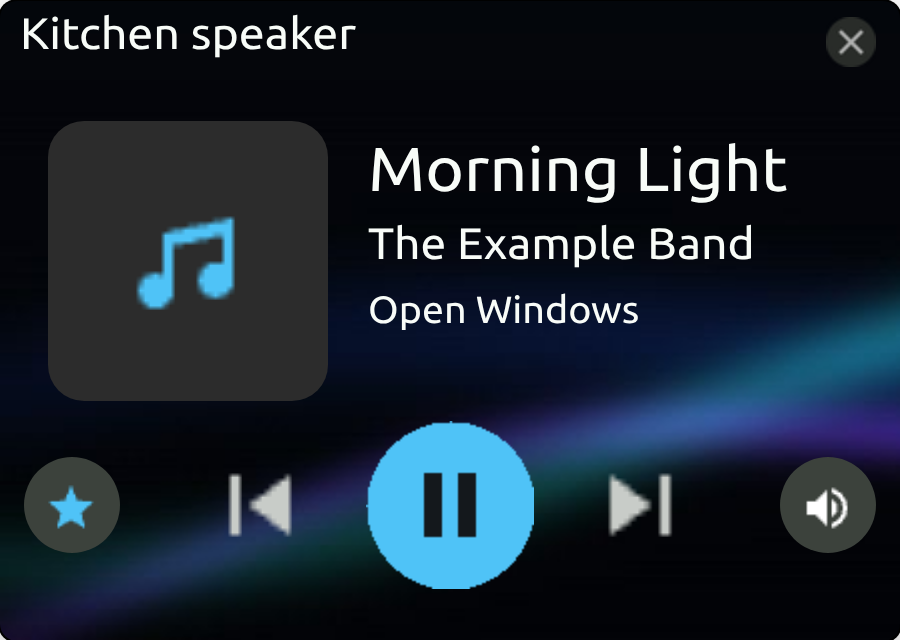</td>
<td>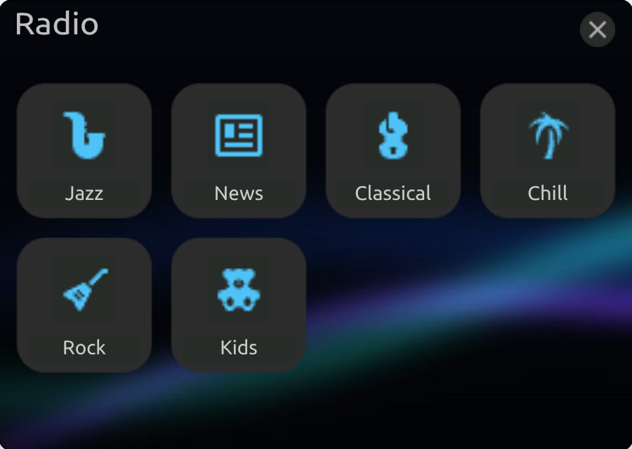</td>
<td>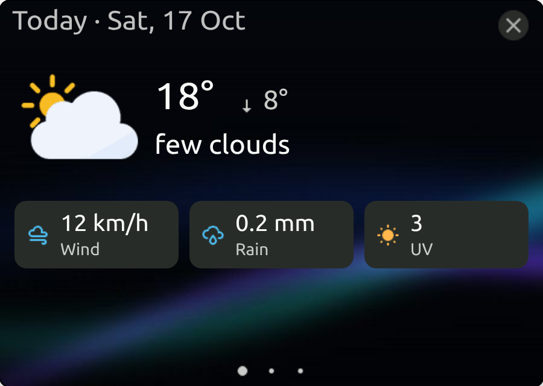</td>
</tr>
<tr><td align="center">Media player</td><td align="center">Stations</td><td align="center">Weather</td></tr>
<tr>
<td>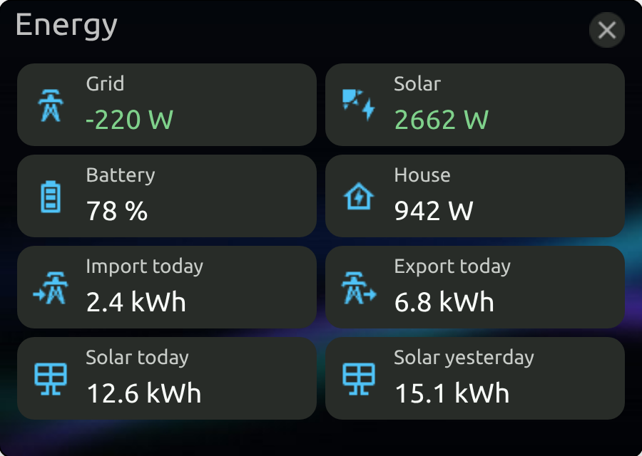</td>
<td>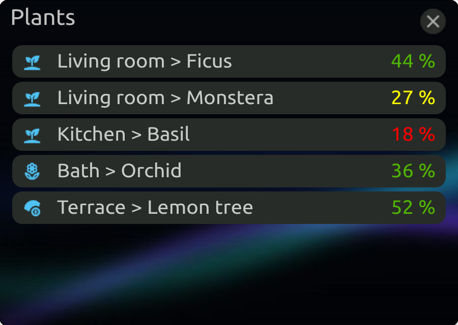</td>
<td>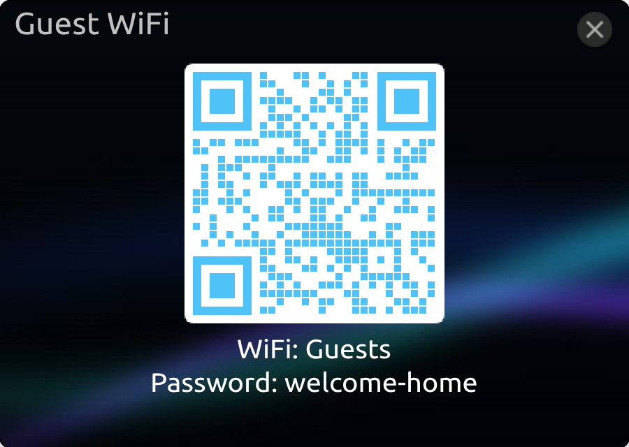</td>
</tr>
<tr><td align="center">Values as cards</td><td align="center">Values as rows, coloured by rules</td><td align="center">Guest WiFi as a QR code</td></tr>
</table>

All of them, and the web interface, are in the [demo](https://bruestel.github.io/ohpanel/demo/): the real
web interface with invented data, the preview working.

## What you need

- A **Sonoff NSPanel**, EU version (the square one) or US version (the tall one; new, not yet tested on a real
  panel); not the NSPanel Pro
- **openHAB**, reachable from the panel's WiFi (tested with openHAB 5.1)
- For the first installation once: a **USB serial adapter with 3.3 V**, a few jumper wires and a small
  flat screwdriver or another thin tool (see [Installation](docs/install.md))

## Quick start

1. Open the panel and connect the serial adapter ([with photos](docs/install.md#connect-the-serial-adapter)).
2. Flash OHpanel in the [browser](https://bruestel.github.io/ohpanel/flash/), or with esptool:
   `ohpanel-nspanel-eu-factory-<version>.bin` (`-us-` for the US version) from the `ohpanel-<version>.zip` of the
   [latest release](https://github.com/bruestel/ohpanel/releases/latest).
3. Close the panel, switch it on and join its open WiFi `ohpanel-xxxxxx`: the setup page opens. Choose your WiFi.
4. In the web interface: connect openHAB (it is found by itself), then write the display design
   (`ohpanel-nspanel-eu-display-<version>.tft`, or `-us-`; about 15 minutes).
5. Build your pages in the web interface, with the preview beside them.

The [installation guide](docs/install.md) has every step, and what to do when one goes wrong.

## Documentation

- [Installation](docs/install.md): from the box to the first page
- [Panel configuration](docs/panel-config.md): pages, home screen, display settings, the JSON reference
- [openHAB items for the example](docs/openhab-items.md): the items of the example configuration, as an `.items` file
- [Weather codes and icons](docs/weather-codes.md): which icon each code of an openHAB weather add-on shows
- [Flashing in detail](docs/flashing.md): what is on the flash, esptool and PlatformIO, migrating
- [Crash analysis](docs/crash-analysis.md): core dumps
- [Development](docs/development.md): building, the layout of the repository, the demo and the screenshots

## Credits

The display design is built as code from an empty Nextion project, inspired by the
[NSPanel HA Blueprint](https://github.com/Blackymas/NSPanel_HA_Blueprint). Icons:
[Material Design Icons](https://pictogrammers.com/library/mdi/); weather icons:
[Meteocons](https://github.com/basmilius/weather-icons). The teardown photos of
[blakadder](https://blakadder.com/nspanel-teardown/) show the hardware in detail.

## License

Apache License 2.0, see [LICENSE](LICENSE). Third-party parts and their licences:
[THIRD-PARTY-NOTICES.md](THIRD-PARTY-NOTICES.md).
