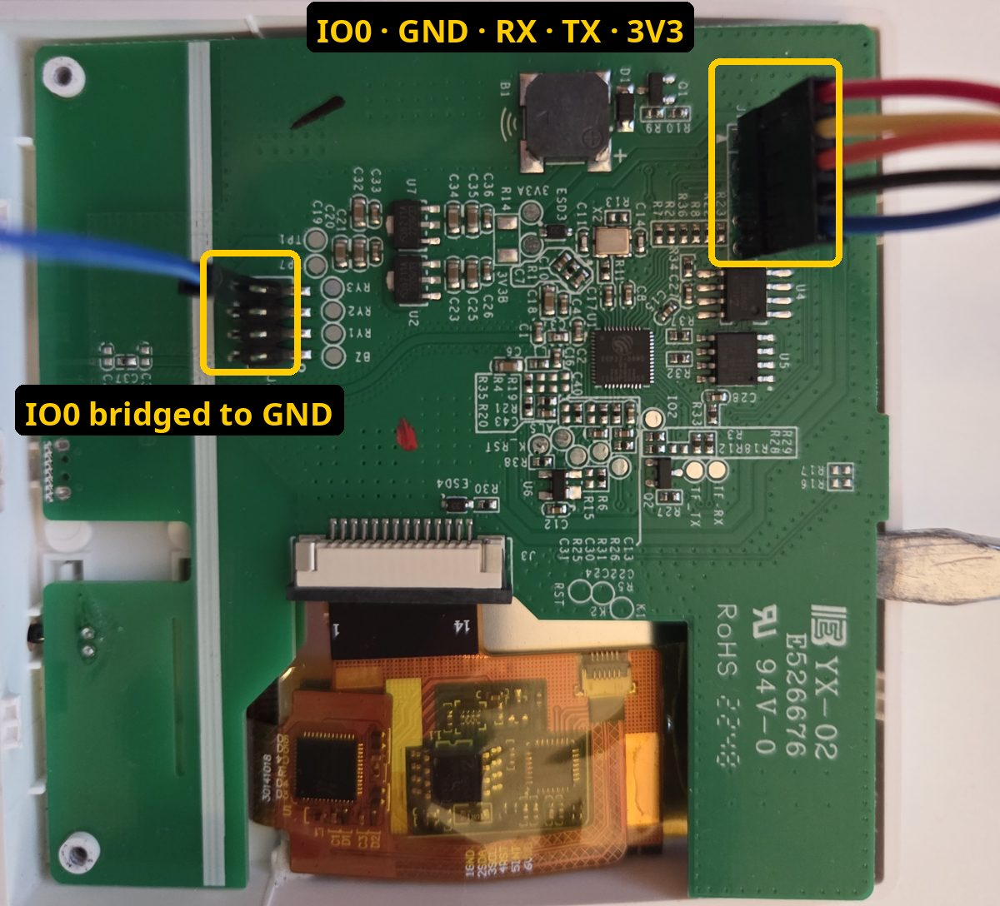
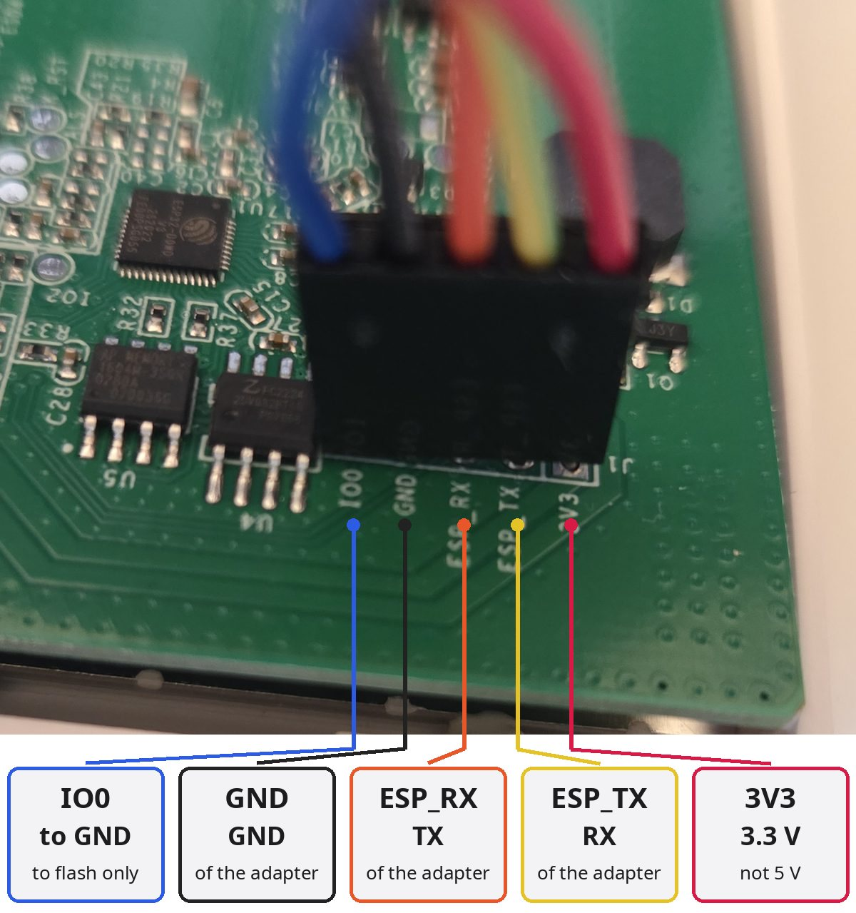
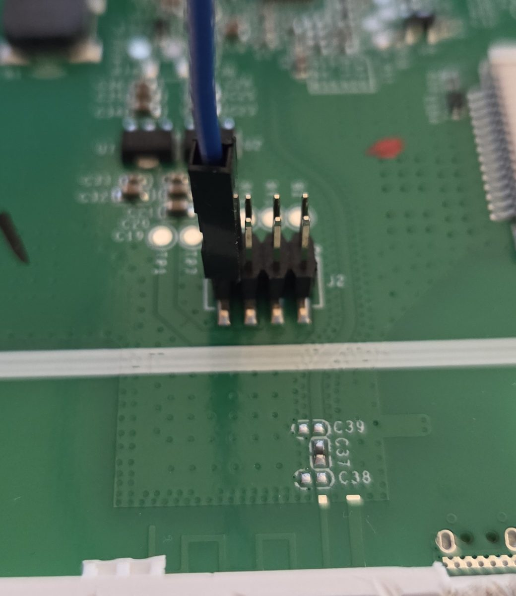
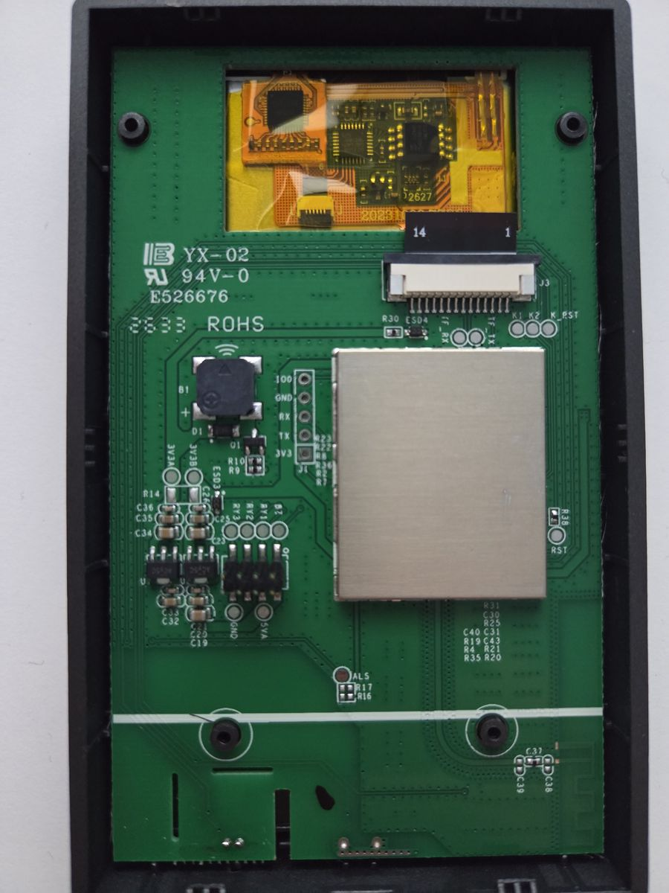
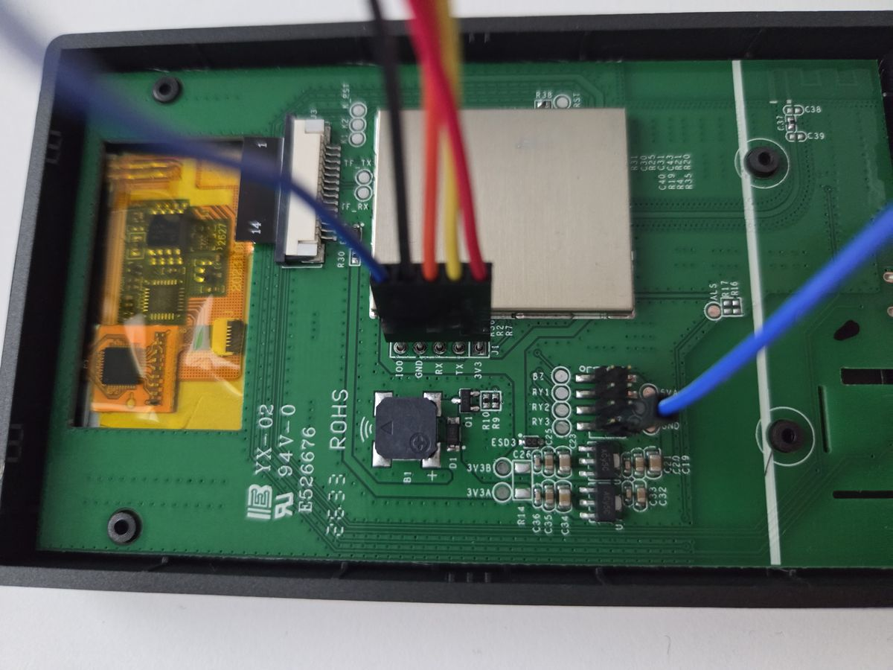
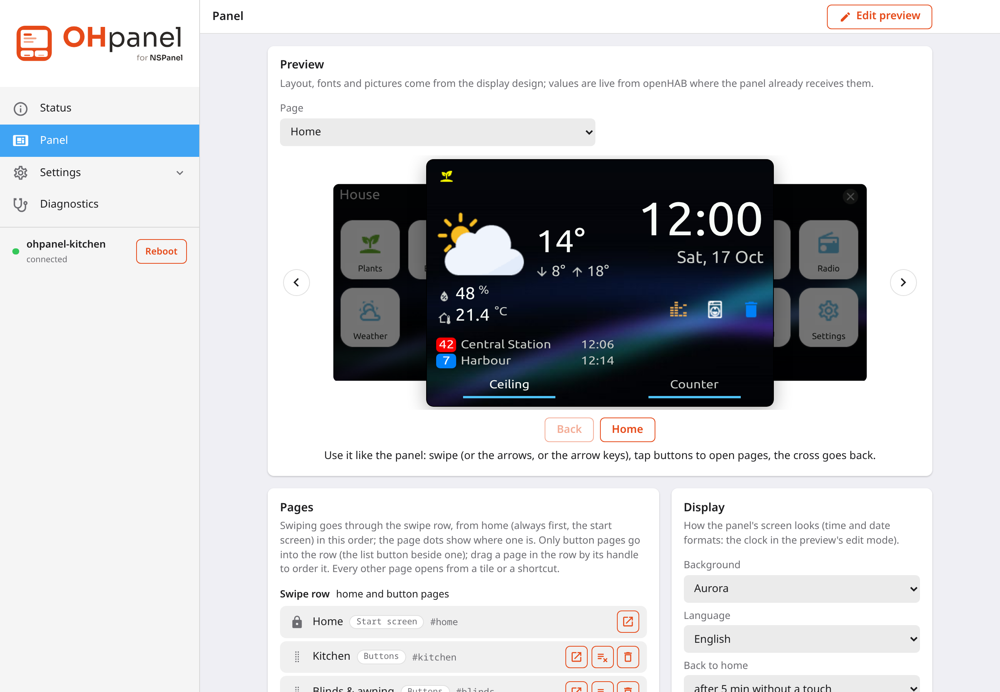
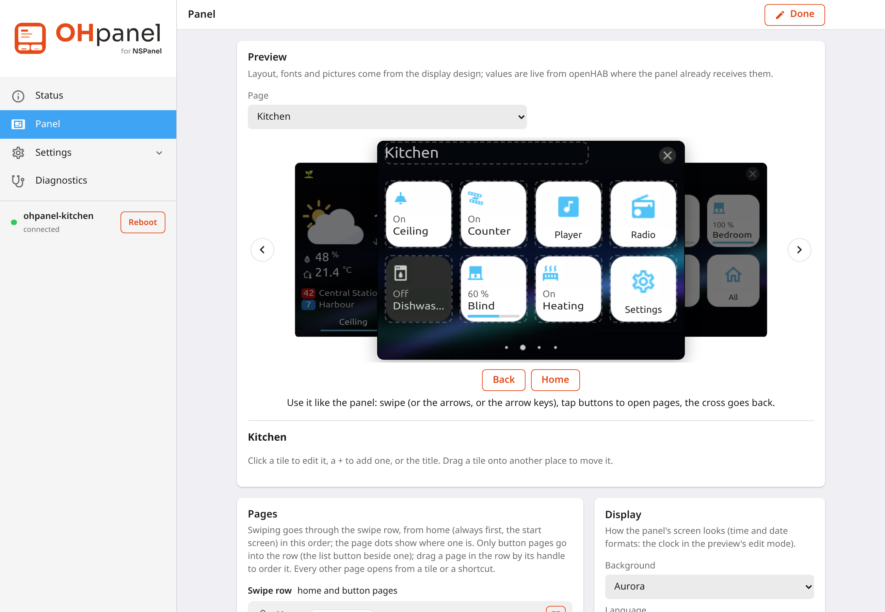

# Installation

From the box to the first page of your own. The first installation needs a serial cable once; everything after
that, the updates of the firmware and of the display's design, comes over WiFi from the panel's web interface.

> [!IMPORTANT]
> OHpanel is for the **Sonoff NSPanel**: the **EU version** (the square one) and the **US version** (the tall one),
> upright or on its side with its buttons on the right ("US landscape"). Each has a firmware and a display design
> of its own, `nspanel-eu`, `nspanel-us` or `nspanel-us-landscape` in the files' names below; take the ones of your
> panel (a panel refuses another's firmware; the US one takes either of its two, to turn it on the wall later).
> The photos show both versions. The NSPanel Pro is a different device.

**Contents:** [What you need](#what-you-need) · [Safety](#safety) · [Open the panel](#open-the-panel) ·
[Connect the serial adapter](#connect-the-serial-adapter) · [Flash](#flash) · [Join your WiFi](#join-your-wifi) ·
[Connect openHAB](#connect-openhab) · [Write the display design](#write-the-display-design) ·
[Your first pages](#your-first-pages) · [Updates](#updates) · [More panels](#more-panels) ·
[When something goes wrong](#when-something-goes-wrong)

## What you need

- the NSPanel (EU or US)
- a **USB serial adapter that works at 3.3 V** (CP2102, CH340, FT232 ...; one with a 3.3 V / 5 V jumper set to 3.3 V)
- **5 jumper wires** (female, for the panel's pin header) and one more to bridge IO0 to ground
- a small **flat screwdriver** or another thin tool to open the case
- a computer with Chrome or Edge (for the [browser flasher](https://bruestel.github.io/ohpanel/flash/)) or with
  [esptool](https://docs.espressif.com/projects/esptool/en/latest/esp32/installation.html)
- the zip for your panel from the [latest release](https://github.com/bruestel/ohpanel/releases/latest),
  `ohpanel-nspanel-eu-<version>.zip` (or `-us-`, `-us-landscape-`), unpacked: `ohpanel-nspanel-eu-factory-<version>.bin` (the first
  flash), `ohpanel-nspanel-eu-display-<version>.tft` (the display's design) and
  `ohpanel-nspanel-eu-firmware-<version>.bin` (for updates later), with their licences
- **openHAB**, reachable from the panel's WiFi

## Safety

> [!CAUTION]
> The NSPanel runs on mains voltage. **Take it off the wall and disconnect it from mains before you open it**,
> and never connect mains while it is open or while the serial adapter is connected: the adapter powers the
> panel with 3.3 V, which is all the flashing needs.

- Use **3.3 V**, not 5 V, on the 3V3 pin.
- The pins of the header are fragile; pull the wires off straight.
- Keep the screws and the small parts together.

## Open the panel

Take the panel off its wall box and disconnect it from mains. Lever the front off the back carefully, with the
flat screwdriver or any other thin tool; the main board with the ESP32 sits behind the display. Lay the front face down.
A metal plate lies behind the main board: keep the board raised a little off it while you work, so that no pin
or wire touches the plate.
[blakadder's teardown](https://blakadder.com/nspanel-teardown/) shows where to lever and the board in detail.

## Connect the serial adapter

The main board has a 5-pin header: **IO0 · GND · ESP_RX · ESP_TX · 3V3** on the EU version, **IO0 · GND · RX ·
TX · 3V3** (J1) on the US version. For flashing, IO0 is tied to ground (GND): on the EU version for example to one
of the two lower pins of the header J2, on the US version to the pad **GND** under the small 2 x 4 header, beside
**5VA**.

| Panel | Adapter |
|---|---|
| IO0 | to GND (flashing only) |
| GND | GND |
| ESP_RX (US: RX) | TX |
| ESP_TX (US: TX) | RX |
| 3V3 | 3.3 V |

RX and TX cross: the panel's RX goes to the adapter's TX and the other way round.

**EU version**

**US version**

Connect the adapter's 3.3 V last (or plug the adapter into the computer last): with IO0 on ground while the
panel gets power, the ESP32 starts its bootloader and waits for the flash.

## Flash

Coming from other firmware (Sonoff's own, Tasmota, ESPHome), erase the flash first: their settings are not
taken over. To keep Sonoff's own firmware, save it before: `esptool --port /dev/ttyUSB0 read_flash 0 0x400000
nspanel-stock.bin` (4 MB, about a minute at `--baud 921600`); `write_flash 0 nspanel-stock.bin` brings it back.
The display's design cannot be saved: a Nextion display can only be written, not read. Flash over the serial port even where the other firmware could take OHpanel over WiFi (Tasmota's
update can): that keeps its partition table, in which OHpanel cannot store its configuration nor update itself.

**In the browser** (Chrome or Edge): open the [OHpanel flasher](https://bruestel.github.io/ohpanel/flash/),
click *Connect*, choose the adapter's port and *Install OHpanel*. Tick *Erase device* to erase it first.

**With esptool** (the file from the release's zip; the port is `COM3` or similar on Windows):

    esptool --chip esp32 --port /dev/ttyUSB0 --after no_reset erase_flash
    esptool --chip esp32 --port /dev/ttyUSB0 --baud 460800 write_flash 0x0 ohpanel-nspanel-eu-factory-<version>.bin

`--after no_reset` keeps the panel in its bootloader after the erase. Without it, or when esptool cannot connect
for the second command, put the panel back into the bootloader: power off, IO0 on ground, power on.

When it is written: take the wire off IO0, power the panel off and on (unplug the adapter and plug it in again).
It starts OHpanel. Disconnect the adapter, close the case and put the panel back on the wall.

## Join your WiFi

Switched on, the panel opens an **open WiFi network named `ohpanel-xxxxxx`** (the last six characters of its
address). Join it with a phone or a computer, then open the setup page at `http://192.168.4.1` in the browser; it does
not open by itself.

> [!NOTE]
> The display still shows the design of the firmware before (Sonoff's, say) until you write OHpanel's in a few
> steps: find the network in your WiFi list, not on the screen. Once OHpanel's design runs, the panel's start
> page shows the network and a QR code to join it.

Choose your WiFi and enter its password. The panel joins it, the hotspot closes, and the panel is reachable at
`http://ohpanel-xxxxxx.local` (or its address from your router). The web interface:

Give it a name of its own under **Device** (`ohpanel-kitchen`): it becomes the panel's `.local` name too.

## Connect openHAB

Under **openHAB**, the panel looks for openHAB in your network and offers what it finds; or enter its address
(`openhab.local:8080`). Over https it offers to trust openHAB's own certificate and shows its fingerprint to
compare.

openHAB lets clients read and command items without a login by default (its *implicit user role*). If you have
turned that off (recommended), create an account with the *user* role for the panels, and an **API token**
for it in openHAB (its profile → *Create new API token*), and enter the token here. **Test connection**, then
**Save**.

## Write the display design

Under **Firmware → Display firmware**, choose `ohpanel-nspanel-eu-display-<version>.tft` (`-us-` on a US panel; the
page names the file it wants) and write it. It takes
about **15 minutes** over WiFi; the screen stays dark meanwhile, then shows OHpanel's start page.

> [!TIP]
> The firmware knows which design it was built for: while the display runs another one, every page of the web
> interface says so and names the file. Firmware and display design of the same release belong together.

## Your first pages

Under **Panel**, the preview shows the display as it is now. **Edit preview** turns it into the editor: tap a
tile to change it, a `+` to add one, the title to rename the page, drag a tile onto another place to move it.
A page's type (buttons, light, cover, media, entities, weather, ...) decides what it shows; the items come from
openHAB, with a search. Saved, the panel shows it at once.

The [panel configuration](panel-config.md) describes every page type and option, and the JSON the web interface
writes. The [demo](https://bruestel.github.io/ohpanel/demo/) has an example of each.

## Updates

**Firmware → Firmware update**: choose `ohpanel-nspanel-eu-firmware-<version>.bin` (`-us-` on a US panel) from the
release's zip. The panel
writes it, restarts and keeps everything it was set up with. If the release has a new display design, the web
interface asks for it: write it as above.

A new image is tried first: if it does not come up and reach the network, the panel goes back to the one before.

## More panels

Each panel is set up on its own. To start a second one like the first:

- **Maintenance → Backup** on the first, with the panel configuration (and, if you like, the passwords: the
  WiFi password, the openHAB token, the web password), and **Restore** it on the new one, in its setup
  hotspot, before it even has a network. Then give it its own name under **Device**.
- **HTTPS:** each panel makes a certificate authority (CA) of its own, to be trusted once per device. For
  several panels, make one CA (`tools/make_ca.sh "My home CA"`) and upload it to each under
  **Security → Use your own CA**: then your devices trust all panels at once.

## When something goes wrong

**The panel's network does not show up.** The hotspot opens when the panel has no network to join. If it was
set up before, it tries that network first; the hotspot follows when it is not reached. Is IO0 still on ground?
Then the bootloader waits instead of starting OHpanel.

**Writing the display design stops.** Start it again; the panel switches the display off and on when a broken
upload left it stuck. A weak WiFi makes it slow, not wrong: it may take 20 minutes.

**The screen says nothing, the web interface works.** The display runs another design: write
`ohpanel-nspanel-eu-display-<version>.tft` (see above).

**The web password is forgotten.** Hold **both buttons for 15 seconds**: the factory reset erases everything
(WiFi, passwords, openHAB, the configuration; not the firmware and the display design), and the panel opens
its hotspot again. A backup restores the rest.

**It crashed or restarts.** **Diagnostics** shows the reason of the last start, the log and a core dump if
there is one; [Crash analysis](crash-analysis.md) explains how to read it.

**Reporting a problem:** [open an issue](https://github.com/bruestel/ohpanel/issues) with the firmware version
(Status), what you did and what happened, a photo of the screen if it matters, and the log from Diagnostics.
