# Weather codes and icons

<!-- Generated by tools/gen_weather_doc.py from boards/nspanel/nextion/weather-icons.json; do not edit. -->

Home's weather icon and the weather pages show the icon for the code an
openHAB item holds. `codes` in the configuration (`weather_icon`, weather
pages) names the code set of the channel the item is linked to (see
[panel-config.md](panel-config.md)); a code the set does not know shows
the set's default.

The icons are [Meteocons](https://github.com/basmilius/weather-icons) by
Bas Milius (MIT), the fill style.

| Code set | openHAB channel |
|---|---|
| [`openweathermap`](#openweathermap) | OpenWeatherMap icon id (01d ... 50n): openweathermap icon-id, openmeteo icon-id |
| [`openweathermap-condition`](#openweathermap-condition) | OpenWeatherMap condition id (200 ... 804): openweathermap condition-id |
| [`weathercompany`](#weathercompany) | The Weather Company icon code (0 ... 47): weathercompany iconCode |
| [`meteoblue`](#meteoblue) | Meteoblue daily pictocode (1 ... 17): meteoblue condition |
| [`smhi`](#smhi) | SMHI symbol code (1 ... 27): smhi symbol_code |
| [`fmi`](#fmi) | FMI WeatherSymbol3: fmiweather weather-id |
| [`wmo`](#wmo) | WMO weather code (0 ... 99): openmeteo weather-code |
| [`darksky`](#darksky) | Dark Sky icon names: pirateweather icon-id, visualcrossing icon |

## openweathermap

OpenWeatherMap icon id (01d ... 50n): openweathermap icon-id, openmeteo icon-id.

| Code | Icon |
|---|---|
| `01d` |  `clear-day` |
| `01n` |  `clear-night` |
| `02d` |  `partly-cloudy-day` |
| `02n` |  `partly-cloudy-night` |
| `03d` |  `cloudy` |
| `03n` |  `cloudy` |
| `04d` |  `overcast-day` |
| `04n` |  `overcast-night` |
| `09d` |  `partly-cloudy-day-rain` |
| `09n` |  `partly-cloudy-night-rain` |
| `10d` |  `rain` |
| `10n` |  `rain` |
| `11d` |  `thunderstorms-day-rain` |
| `11n` |  `thunderstorms-night-rain` |
| `13d` |  `snow` |
| `13n` |  `snow` |
| `50d` |  `fog-day` |
| `50n` |  `fog-night` |
| any other |  `not-available` |

## openweathermap-condition

OpenWeatherMap condition id (200 ... 804): openweathermap condition-id.

| Code | Icon |
|---|---|
| `200` |  `thunderstorms-rain` |
| `201` |  `thunderstorms-rain` |
| `202` |  `thunderstorms-rain` |
| `210` |  `thunderstorms` |
| `211` |  `thunderstorms` |
| `212` |  `thunderstorms` |
| `221` |  `thunderstorms` |
| `230` |  `thunderstorms-rain` |
| `231` |  `thunderstorms-rain` |
| `232` |  `thunderstorms-rain` |
| `300` |  `drizzle` |
| `301` |  `drizzle` |
| `302` |  `drizzle` |
| `310` |  `drizzle` |
| `311` |  `drizzle` |
| `312` |  `drizzle` |
| `313` |  `drizzle` |
| `314` |  `drizzle` |
| `321` |  `drizzle` |
| `500` |  `rain` |
| `501` |  `rain` |
| `502` |  `rain` |
| `503` |  `rain` |
| `504` |  `rain` |
| `511` |  `sleet` |
| `520` |  `partly-cloudy-day-rain` |
| `521` |  `partly-cloudy-day-rain` |
| `522` |  `partly-cloudy-day-rain` |
| `531` |  `partly-cloudy-day-rain` |
| `600` |  `snow` |
| `601` |  `snow` |
| `602` |  `snow` |
| `611` |  `sleet` |
| `612` |  `sleet` |
| `613` |  `sleet` |
| `615` |  `sleet` |
| `616` |  `sleet` |
| `620` |  `partly-cloudy-day-snow` |
| `621` |  `partly-cloudy-day-snow` |
| `622` |  `partly-cloudy-day-snow` |
| `701` |  `mist` |
| `711` |  `smoke` |
| `721` |  `haze` |
| `731` |  `dust-wind` |
| `741` |  `fog` |
| `751` |  `dust` |
| `761` |  `dust` |
| `762` |  `smoke` |
| `771` |  `wind` |
| `781` |  `tornado` |
| `800` |  `clear-day` |
| `801` |  `partly-cloudy-day` |
| `802` |  `partly-cloudy-day` |
| `803` |  `overcast-day` |
| `804` |  `overcast` |
| any other |  `not-available` |

## weathercompany

The Weather Company icon code (0 ... 47): weathercompany iconCode.

| Code | Icon |
|---|---|
| `0` |  `tornado` |
| `1` |  `hurricane` |
| `2` |  `hurricane` |
| `3` |  `thunderstorms-rain` |
| `4` |  `thunderstorms` |
| `5` |  `sleet` |
| `6` |  `sleet` |
| `7` |  `sleet` |
| `8` |  `drizzle` |
| `9` |  `drizzle` |
| `10` |  `sleet` |
| `11` |  `rain` |
| `12` |  `rain` |
| `13` |  `snow` |
| `14` |  `partly-cloudy-day-snow` |
| `15` |  `snow` |
| `16` |  `snow` |
| `17` |  `hail` |
| `18` |  `sleet` |
| `19` |  `dust-wind` |
| `20` |  `fog` |
| `21` |  `haze` |
| `22` |  `smoke` |
| `23` |  `wind` |
| `24` |  `wind` |
| `25` |  `snow` |
| `26` |  `cloudy` |
| `27` |  `overcast-night` |
| `28` |  `overcast-day` |
| `29` |  `partly-cloudy-night` |
| `30` |  `partly-cloudy-day` |
| `31` |  `clear-night` |
| `32` |  `clear-day` |
| `33` |  `partly-cloudy-night` |
| `34` |  `partly-cloudy-day` |
| `35` |  `hail` |
| `36` |  `clear-day` |
| `37` |  `thunderstorms-day` |
| `38` |  `thunderstorms-day-rain` |
| `39` |  `partly-cloudy-day-rain` |
| `40` |  `rain` |
| `41` |  `partly-cloudy-day-snow` |
| `42` |  `snow` |
| `43` |  `snow` |
| `44` |  `not-available` |
| `45` |  `partly-cloudy-night-rain` |
| `46` |  `partly-cloudy-night-snow` |
| `47` |  `thunderstorms-night-rain` |
| any other |  `not-available` |

## meteoblue

Meteoblue daily pictocode (1 ... 17): meteoblue condition.

| Code | Icon |
|---|---|
| `1` |  `clear-day` |
| `2` |  `partly-cloudy-day` |
| `3` |  `partly-cloudy-day` |
| `4` |  `overcast` |
| `5` |  `fog` |
| `6` |  `rain` |
| `7` |  `partly-cloudy-day-rain` |
| `8` |  `thunderstorms-day-rain` |
| `9` |  `snow` |
| `10` |  `partly-cloudy-day-snow` |
| `11` |  `sleet` |
| `12` |  `drizzle` |
| `13` |  `snow` |
| `14` |  `rain` |
| `15` |  `snow` |
| `16` |  `drizzle` |
| `17` |  `snow` |
| any other |  `not-available` |

## smhi

SMHI symbol code (1 ... 27): smhi symbol_code.

| Code | Icon |
|---|---|
| `1` |  `clear-day` |
| `2` |  `partly-cloudy-day` |
| `3` |  `partly-cloudy-day` |
| `4` |  `partly-cloudy-day` |
| `5` |  `cloudy` |
| `6` |  `overcast` |
| `7` |  `fog` |
| `8` |  `partly-cloudy-day-rain` |
| `9` |  `partly-cloudy-day-rain` |
| `10` |  `partly-cloudy-day-rain` |
| `11` |  `thunderstorms-rain` |
| `12` |  `partly-cloudy-day-sleet` |
| `13` |  `partly-cloudy-day-sleet` |
| `14` |  `partly-cloudy-day-sleet` |
| `15` |  `partly-cloudy-day-snow` |
| `16` |  `partly-cloudy-day-snow` |
| `17` |  `partly-cloudy-day-snow` |
| `18` |  `drizzle` |
| `19` |  `rain` |
| `20` |  `rain` |
| `21` |  `thunderstorms` |
| `22` |  `sleet` |
| `23` |  `sleet` |
| `24` |  `sleet` |
| `25` |  `snow` |
| `26` |  `snow` |
| `27` |  `snow` |
| any other |  `not-available` |

## fmi

FMI WeatherSymbol3: fmiweather weather-id.

| Code | Icon |
|---|---|
| `1` |  `clear-day` |
| `2` |  `partly-cloudy-day` |
| `3` |  `cloudy` |
| `21` |  `partly-cloudy-day-drizzle` |
| `22` |  `partly-cloudy-day-rain` |
| `23` |  `partly-cloudy-day-rain` |
| `31` |  `drizzle` |
| `32` |  `rain` |
| `33` |  `rain` |
| `41` |  `partly-cloudy-day-snow` |
| `42` |  `partly-cloudy-day-snow` |
| `43` |  `partly-cloudy-day-snow` |
| `51` |  `snow` |
| `52` |  `snow` |
| `53` |  `snow` |
| `61` |  `thunderstorms-day-rain` |
| `62` |  `thunderstorms-rain` |
| `63` |  `thunderstorms` |
| `64` |  `thunderstorms` |
| `71` |  `partly-cloudy-day-sleet` |
| `72` |  `partly-cloudy-day-sleet` |
| `73` |  `partly-cloudy-day-sleet` |
| `81` |  `sleet` |
| `82` |  `sleet` |
| `83` |  `sleet` |
| `91` |  `haze` |
| `92` |  `fog` |
| any other |  `not-available` |

## wmo

WMO weather code (0 ... 99): openmeteo weather-code.

| Code | Icon |
|---|---|
| `0` |  `clear-day` |
| `1` |  `partly-cloudy-day` |
| `2` |  `partly-cloudy-day` |
| `3` |  `overcast` |
| `45` |  `fog` |
| `48` |  `fog` |
| `51` |  `drizzle` |
| `53` |  `drizzle` |
| `55` |  `drizzle` |
| `56` |  `sleet` |
| `57` |  `sleet` |
| `61` |  `rain` |
| `63` |  `rain` |
| `65` |  `rain` |
| `66` |  `sleet` |
| `67` |  `sleet` |
| `71` |  `snow` |
| `73` |  `snow` |
| `75` |  `snow` |
| `77` |  `snow` |
| `80` |  `partly-cloudy-day-rain` |
| `81` |  `partly-cloudy-day-rain` |
| `82` |  `rain` |
| `85` |  `partly-cloudy-day-snow` |
| `86` |  `snow` |
| `95` |  `thunderstorms-rain` |
| `96` |  `thunderstorms-rain` |
| `97` |  `thunderstorms-rain` |
| `99` |  `thunderstorms-rain` |
| any other |  `not-available` |

## darksky

Dark Sky icon names: pirateweather icon-id, visualcrossing icon.

| Code | Icon |
|---|---|
| `clear-day` |  `clear-day` |
| `clear-night` |  `clear-night` |
| `thunderstorm` |  `thunderstorms-rain` |
| `rain` |  `rain` |
| `snow` |  `snow` |
| `sleet` |  `sleet` |
| `wind` |  `wind` |
| `fog` |  `fog` |
| `cloudy` |  `cloudy` |
| `partly-cloudy-day` |  `partly-cloudy-day` |
| `partly-cloudy-night` |  `partly-cloudy-night` |
| `hail` |  `hail` |
| `none` |  `not-available` |
| any other |  `not-available` |
